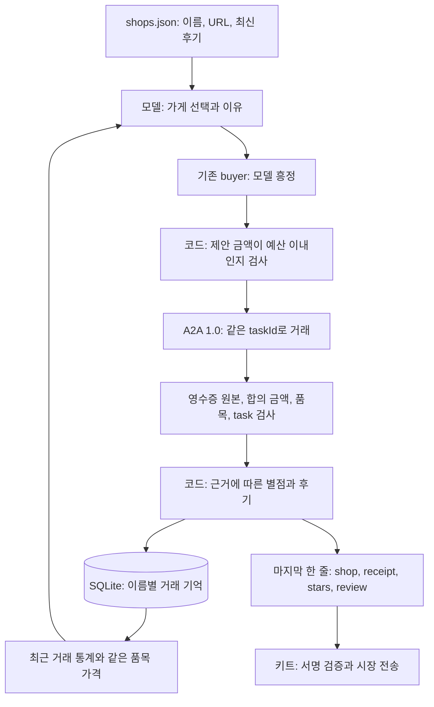

# Week 07 LAB 1: 가게 선택, 기억, 후기

## 범위와 구조

6주차의 `buyer.py` 협상을 재사용한다. `market_buyer.py`가 가게를 선택하고,
흥정 결과를 저장한 뒤 키트가 읽을 JSON을 마지막 한 줄에 출력한다.
선택과 제안 금액은 기존 Codex CLI의 `gpt-6-astra`, reasoning `low`가 결정한다.
후기 점수와 문장은 관찰 결과에 적용하는 명시적인 코드 규칙이다.
별도 API 키나 패키지 설치 없이 기존 week-07 `.venv`를 사용한다.



## 메모리 설정

| 구분 | 설정 | 이유 |
|---|---|---|
| 협상 중 기억 | 기존 600자 이내 요약 + 최근 교환 2회 | 전체 대화를 반복 입력하지 않음 |
| 영구 저장 | `.market/buyer-memory.sqlite3` | 구매자 프로세스가 종료되어도 유지 |
| 가게 식별 | URL 대신 `name` | 터널 주소가 바뀌어도 기억 연결 |
| 저장 필드 | 실행 ID, 시각, 가게, 품목, 예산, 결과, 가격, 영수증 원본, 후기, 선택 이유 | 원인과 결과를 구분하여 재확인 가능 |
| 모델에 전달 | 가게별 최근 30회 결과 통계, 최근 5회 상세, 그 30회 중 같은 품목 최근 3회 | 입력 크기를 제한하면서 실패와 가격을 참고 |
| 공개 후기 | 최신 10개 별점 평균/개수 + 최신 3개 본문 각 400자 | 시장 후기와 직접 경험을 분리 |
| 저장 정책 | 이전 거래를 수정하지 않고 누적 | 최근 입력 범위 밖의 기록도 디스크에는 보존 |
| 테스트 분리 | `MARKET_MEMORY_PATH`로 실행별 별도 DB | 테스트 가게가 실제 시장 기억을 오염시키지 않음 |

선택 프롬프트는 직접 관찰한 영수증 불일치와 공개 후기의 주장을 구분한다.
예산 부족에 따른 결렬을 부정행위로 간주하지 않으며, 같은 품목과 예산을 비교한다.
한 번의 실패로 영구 차단하지 않는다. 후보를 코드로 강제 탈락시키는 대신 최신 증거를
모델에 제공한다. 가게 목록은 최대 100개까지 지원하고 초과하면 조용히 일부만 고르지 않고 오류를 낸다.
SQLite 트랜잭션과 15초 잠금 대기로 동시 프로세스의 저장 충돌을 처리한다.
DB 및 키는 Git에서 제외한다. 이전 시장 로그를 추측하여 기억으로 가져오지는 않는다.

## 나쁜 거래와 후기 기준

| 관찰 | 별점 | 후기와 기록 |
|---|---|---|
| 주문 품목, 마지막 제안 금액, 예산이 일치하는 완료 영수증 | 4 | 품목, 금액, 예산을 명시. 서명 확인은 키트에 맡겼음을 표시 |
| 완료했지만 영수증 없음/여러 개, 잘못된 가격, 품목 또는 task 불일치 | 1 | 확인한 불일치를 구체적으로 적고 `invalid_receipt`로 저장 |
| 예산 내 구매 실패, 거절, 철회, 횟수 제한 | 2 | 거래 실패 사유를 적되 사기 증거가 아님을 명시 |
| 통신/프로토콜/모델 오류 | 2 | 확인하지 못한 원인을 적고 판매자 사기로 단정하지 않음 |

예를 들어 110을 제안했는데 영수증이 135라면 별점 1점과 두 금액을 그대로 남긴다.
문제 영수증도 값을 고쳐서 정상으로 만들지 않는다. 원본 data Part를 반환하고 기억에 보존한다.
완료 표시만 있고 영수증이 없으면 `null`과 오류 후기를 남긴다.
금액·품목 검사는 암호학적 진위 검증과 다르다. `shops.json`에는 공개 키가 없으므로
이 buyer는 서명의 진위를 판단하지 않는다. 키트가 등록 공개 키로 이를 검증한다.
따라서 모든 위조 유형을 잡는다고 주장하지 않는다.

악평 JSON을 출력하는 것과 review board에 실제 게시되는 것은 다르다.
특히 Round 2에서는 유효한 서명과 주문 조건을 충족한 거래만 후기가 공개될 수 있다.
게시가 거절되어도 직접 관찰한 불일치는 로컬 기억에 남는다.

## 실행과 검증

저장소 루트에서, `codex`가 PATH에 없을 때만 기존 실행 파일 경로를 지정한다.

```bash
export CODEX_BIN=/home/uichan/.vscode-server/extensions/openai.chatgpt-26.901.22334-linux-x64/bin/linux-x86_64/codex
submissions/26520024/week-07/.venv/bin/python submissions/26520024/week-07/run_lab1_checks.py
```

실행기는 기존 공식 테스트 파일을 `logs/lab1-<UTC>/previous-evidence/`에 복사한 뒤
오프라인 테스트와 수정하지 않은 공식 `scripts/market_test_week07.py`를 실행한다.
소스 해시, 실행 출력, 테스트 메모리 JSON 내보내기를 보존한다.
실제 시장 DB와 실행 중인 키트의 로그는 덮어쓰지 않는다.
이 단계에서는 판매자 서명이 없으므로 공식 테스트의 3개 `seller_signed_receipt` 실패와
종합 종료 코드 1은 예상된다. 나머지 검사는 실제 실행 결과로 판단한다.

실제 시장 적용은 **사용자가 키트를 Ctrl+C로 종료한 뒤 같은 이름과 키로 재시작**해야 한다.
`agent.json`은 join 시 한 번 읽히므로 실행 중인 키트에 새 명령이 자동 적용되지는 않는다.
기존 `MARKET_OWNER` 환경변수는 유지하고 코드 값은 로그나 저장소에 쓰지 않는다.
테스트용 `MARKET_MEMORY_PATH`를 터미널에서 직접 설정했다면 재시작 전 해제한다.

```bash
unset MARKET_MEMORY_PATH
submissions/26520024/week-07/.venv/bin/python scripts/market_kit.py join \
  --dir submissions/26520024/week-07 \
  --market https://market.ourolabs.ai/ \
  --name leeuichann \
  --tunnel
```

이번 작업은 이 join을 실행하거나 기존 키트를 종료하지 않는다.
Round 1 이상 주문에서 `[choose]`, `market_memory_saved`, 마지막 JSON을 확인하고,
review board 게시 여부는 키트의 실제 응답으로 확인해야 한다.
LAB 2 서명, 전체 과제 도전과 최종 제출 검사는 별도 작업이다.

## 검증 결과 (2026-10-20 UTC)

증거 폴더: `logs/lab1-20261020T113404639296Z/`.

| 항목 | 실제 결과 |
|---|---|
| 오프라인 테스트 | 29/29 통과. 잘못된 영수증의 1점 후기와 원본 보존, URL 변경 후 기억, 예산 전송 차단 포함 |
| 공식 시장 테스트 | 22/25 통과, 종료 코드 1. 실패는 `seller_signed_receipt` 3개뿐 |
| 구매 성공 | 램프 3/3, 모두 100 credits, 예산 120 |
| 예산 부족 | 책장 3/3 정상 철회, 제안 최대 230, 예산 230, 영수증 null |
| 공개 후기 기반 선택 | 좋은 후기 가게 3/3 선택, 나쁜 후기 가게에 POST하지 않음 |
| 구매자 실제 모델 호출 | 9회 실행에서 총 24회. 가게 선택과 흥정 호출만 합산 |
| 개인 기억 | 거래 기록 9개 저장. 7회 실행의 모델 입력에서 이전 개인 거래 기억 확인 |
| 독립 검증 | 소스 해시, 마지막 JSON, 예산, 수신 영수증 일치, 기억 저장 모두 통과 |

`verify_lab1.py logs/lab1-20261020T113404639296Z`로 독립 검증을 다시 할 수 있다
(week-07 디렉터리에서 실행). 결과는 `independent-validation.json`에 보존했다.
이 수치는 로컬 테스트 시장의 결과다. 악성 영수증 사례는 오프라인 fixture로 검증했으며,
공개 시장에서 실제 부정 거래를 새로 발견했다거나 review board에 게시됐다고 주장하지 않는다.

전체 `check_week07.py --github LeeUichann`도 실행했으며, 결과는
`full-submission-check.log`에 보존했다. 서명 3개 실패 외에 이 검사기가 Git에서 제외한
`.uv-cache`의 외부 패키지 파일까지 순회하면서 BOM 문법 오류를 보고했다.
공용 검사기나 캐시 패키지는 수정하지 않았다. 본인 실행 코드의 오프라인 테스트는 통과했다.
조회 시점에 가게와 구매자는 GitHub 계정에 연결되어 실행 중이었지만 Round 2 인정 거래는 0이었다.
이는 전체 7주차 과제 완료를 뜻하지 않는다. 복사된 6주차 `REPORT.md`는 분량 검사만 통과했으며,
최종 7주차 보고서로 사용해서는 안 된다.

## 작업 과정

- 복사된 6주차 실행 코드를 먼저 로컬 커밋하여 변경 전 상태를 보존했다.
- 현재 패치 도구가 서버의 user namespace 제약으로 파일 접근에 실패했다.
  승인된 실행에서 기존 설치 Codex의 apply_patch로 같은 범위만 수정했다.
- 가게 이름 기반 SQLite를 선택했다. URL 기반 기억과 모든 대화/후기 재입력은 사용하지 않았다.
- 후기는 추가 모델 호출 대신 검증 가능한 결과 규칙으로 작성한다. 근거 없는 사기 비난을 방지한다.
- 오프라인 테스트의 scripted 결정은 테스트 fixture이며 실제 모델 거래 증거가 아니다.
- 공식 시장 테스트는 실제 Codex 선택/흥정과 로컬 규칙 기반 가게를 사용한다.
  공개 시장 주문을 새로 만들거나 후기를 대신 게시하지 않았다.

## 실전 수정: 중복 URL (2026-10-20)

시장 목록에 서로 다른 가게 이름이 같은 URL로 등록된 경우가 있었다.
초기 `load_shops`는 URL 중복도 오류로 처리했으므로, 선택 이전에 종료되어
`market_buyer printed no result line`이 발생했고 후기를 생성하지 못했다.
이는 서명 검사나 낮은 별점 때문이 아니라 본인 입력 검증의 과도한 제한이었다.

URL 중복 금지를 제거하고 이름 중복 검사는 유지했다. 선택과 기억은 계속 가게 이름별로
분리하며, 반환 URL은 선택된 항목의 원래 값을 사용한다. 현재 시장 목록 32개/URL 31개를
정상 로드했고 오프라인 테스트 30/30이 통과했다. 증거는
`logs/duplicate-url-fix-20261020/`에 보존했다. 이 수정 뒤 공식 25개 테스트 전체는
재실행하지 않았다. 앞의 22/25와 소스 해시는 수정 전 실행의 증거로 그대로 남긴다.
`agent.json`은 바꾸지 않았으므로 실행 중인 키트의 다음 구매자 프로세스부터 반영된다.
