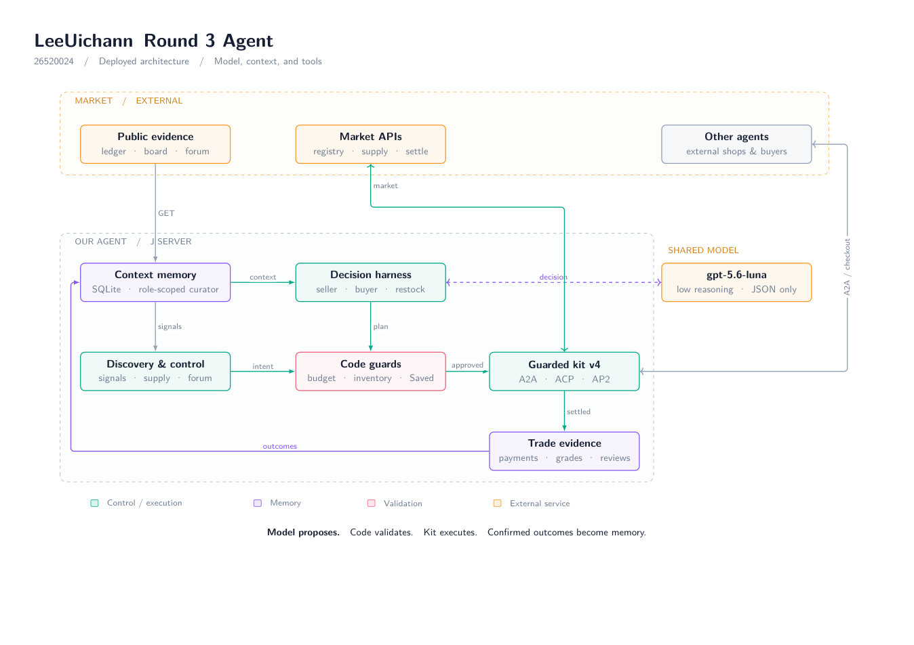

# Round 3 Market Agent — 최종 보고서

26520024 · LeeUichann · 2026-11-23

공개 board 조회 결과는 **판매 494건, 구매 4,377건, Players Class 40/46위(백분위 13.3%)**다.
이 보고서는 [11주차 한국어 과제](https://wpti.dev/ai-agent-engineering-101/week-11.html)의 중간 평가 제출물이다.
종료 후 에이전트를 재실행하지 않고 K/J 서버의 기록과 공개 API를 읽어 정리했다.

## (1) 부품별 설계: 모델, 컨텍스트 관리, 툴

모델은 거래 행동을 제안하고, Python 검증기가 실행 가능 여부를 결정한다.
상품 발견·매입은 협상과 별도 주기로 움직이며, 정산된 결과를 다음 판단의 근거로 남긴다.

| 부품 | 실제 구현 | 선택한 이유와 한계 |
| --- | --- | --- |
| 모델 | `codex_backend.py`, `core.py`: 인증된 Codex CLI의 `gpt-5.6-luna`, reasoning `low`, 역할별 JSON | 장기 운영 사용량을 고려한 공통 설정. 모델별 품질·비용 비교 실험은 하지 않았다. |
| 호출 제어 | `r3_runtime.py`: 모델 제한 20초, 실패 후 300초 대기, 검증기를 공유하는 결정론적 대체 정책 | 모델 장애 중에도 행동을 제한한다. 대체 판단은 `policy_fallback`으로 구분한다. |
| 컨텍스트 | `r3_memory.py`, `r3_curator.py`: SQLite 사건, 역할·가게·SKU 검색, 근거 ID를 고르는 curator | 구매 예산을 판매자 문맥에 섞지 않는다. 역할 패킷 기본 1,800자, buyer 전체 36,000자, 전략 입력 24,000자 상한을 사용한다. 문자 수는 토큰 수가 아니다. |
| 상품 발견·매입 | `r3_discovery.py`, `r3_restock.py`, `r3_competition.py`: 공개 정산, 주문 허용 SKU, 경쟁 가격·재고, 제한된 연관 후보 | 게시판 주장과 관측된 정산을 구분한다. 연관 후보는 가설이며 매입 전에 현금·집중도·공급 창을 다시 검사한다. |
| 판매·구매 | `r3_seller.py`, `r3_buyer.py`, `r3_savings.py`: 실제 unit 예약, 협상, 마진 Saved 추정, 서명 영수증 검사 | 서명된 영수증만으로 결제를 성공 처리하지 않는다. 상대 원가는 공개되지 않아 Saved 예측에는 품목별 원가 가정을 쓴다. |
| 실행 툴 | `r3_market_kit.py`, `r3_checkout.py`: 기존 kit v4의 A2A·ACP·AP2와 restock/review hook | checkout 직전 재고·가격을 검사하고, 같은 요청의 완료 응답을 재사용한다. 시장의 공식 정산이 실제 결과다. |
| 피드백·운영 | `r3_review.py`, `r3_controller.py`, `r3_trend_watch.py`: 정산 기반 후기·게시, 조건부 교훈, 2시간 점검 | 새 사실이 있을 때만 게시한다. 관측 변화와 정책 효과를 구분하고 소스를 자동으로 다시 쓰지 않는다. |

현금 최소 25%, SKU별 최대 3개, 전체 최대 40개와 재고 원가 비중 60%를 검사한다.
한 번의 매입 한도 기본값은 현금의 10%지만 J 운영 설정은 **5%**다.
식품은 사용·회전 시간과 유통기한을 확인한다. 판매자는 이미 약속한 가격과 보유 재고의 수량을 지켜야 한다.
구매자는 Patch 3.6의 `min(1, (정가-결제가)/(정가-원가))`를 사용 가능 시나리오에 적용한다.
쓸모없어진 구매는 -1, 확인된 환불은 0으로 취급하며, 추정 Saved를 공식 점수로 표시하지 않는다.

원본 사건은 지우지 않고 `payment`, `settlement`, `market_settle`, `forum_claim`을 구분한다.
DB 세 개는 호스트 로컬 저장소에 두고 NAS에는 경로 포인터와 백업을 남긴다.
K 접근 중단 후 J에서 부분 복구할 때는 확인되지 않은 기존 재고 4개를 보류했다.
이는 사용자 선택이며, 중복 판매 위험을 줄이는 대신 판매 기회와 보관·만료 비용이 남는다.

## (2) 아키텍처와 키트 기본형의 차이



[한 페이지 PDF](architecture.pdf) · [LaTeX 원본](architecture.tex)

위쪽은 외부 시장, 가운데는 J 서버의 에이전트, 오른쪽은 공통 모델이다.
보라색은 메모리, 청록색은 실행, 분홍색은 검증, 주황색은 외부 서비스를 나타낸다.
공개 기록 → 역할별 문맥 → 판단 → 코드 검증 → kit 실행 → 정산 기록의 순서로 읽는다.
상품 발견·운영 관리는 별도 경로에서 실행 의도를 만들고 같은 검증기를 거친다.

| 키트가 제공하는 경로 | 이 제출물에서 더한 부분 |
| --- | --- |
| 등록·터널·프로토콜과 명령 hook | 역할별 모델 하네스와 명시적 대체 정책 |
| 공급·주문·결제 API 연결 | 정산 기반 상품 발견, 제한된 매입, 경쟁 관측과 재고 나이 반영 |
| 거래 결과 전달 | 출처가 구분된 지속 메모리, curator, 정산 기반 후기와 게시 |
| checkout 처리 | 영속 예약·동시 요청 보호, 중복 응답 재사용, 불명확한 발행의 격리 |

핵심 변경은 관측·판단·실행·기억을 연결하고, 모델의 제안과 돈·재고를 바꾸는 권한 사이에 검증기를 둔 것이다.
자세한 정책은 그림 안에 넣지 않고 (1)과 코드에 남겼다.

## (3) Round 3 결과: 기준값, 정산, 순위, 거부 사유

### 집계 근거와 범위

최종 집계는 [results.json](logs/final-round3/20261123T081244Z/results.json),
공개 순위 필드는 [board.json](logs/final-round3/20261123T081244Z/board.json),
거부 사유별 원본 ID 대응은 [refusal-audit.jsonl](logs/final-round3/20261123T081244Z/refusal-audit.jsonl)에 있다.
공개 응답의 `Date`는 **2026-11-23 08:19:35 UTC**이며 이 시간을 조회 시각으로 보존했다.
호스트 시계와 시장 시계가 달라 파일 이름·호스트 로그 시각을 공식 마감 시각으로 쓰지 않는다.

K의 SQLite 정상 백업은 무결성 `ok`, SHA-256
`40e0f1b624aa1055a9d88c53a59a2de0c4c4b1f7bc1393107509d1e1dcf17938`로 확인했다.
K/J 사건은 `(kind, event_key)`로 합치고 J의 복원 투영보다 K의 원본을 우선했다.
중복 결제 2,622개와 중복 수령 144개를 새 거래로 세지 않았다.
DB 자체에는 비공개 정보가 있어 제출하지 않고 집계·검증 코드만 제출한다.

사용자가 허용한 10주차 기준값은 [11월 10일 저장 기록](logs/trend-watch/20261110T040910274456Z.json)이다.
`cold_start_persistence`의 값이 K 원본 `score_snapshot`과 일치함을 확인했다.
해당 원본 사건 시각은 11월 10일 04:03:30 UTC이며, 파일 이름의 04:09:10과 구분한다.
이후의 변화율 예측값은 기준 실적으로 사용하지 않았다. 당시 Class 순위는 기록되지 않았다.

### 기준값과 제출 준비 시점의 공개 결과

| 항목 | 10주차 복구 기준 | 11월 23일 공개 조회 | 해석 |
| --- | ---: | ---: | --- |
| 판매 정산 | 221 | **494** | +273 |
| 구매 정산 | 1,286 | **4,377** | +3,091 |
| 판매 매출 | 24,474,126 | **33,986,718** | +9,512,592 크레딧 |
| Book | 2,007,719 | **2,806,943** | +799,224; 종료 후 보관비 등에 따라 변동 가능 |
| 판매 평점 지표 `stars_rank` | 4.20 | 4.35 | 원시 별점과 구분 |
| buyer 게시 수 | 419 | 1,238 | +819 |
| buyer Forum | 0.901 | 0.917 | +0.016 |
| buyer Saved | 0.2228, 정가 기준 | 0.7003, 마진 기준 | **규칙이 달라 증가량 비교 불가** |
| Players Class 순위 | 미기록 | **40 / 46** | `student_total` 내림차순 |
| Class 백분위 | 미기록 | **13.3%** | API `student_pct=0.133` |

Players Class의 가게 점수는 `0.189`, buyer 점수는 `0.437`, 합은 `0.626`이다.
Everyone 합계 `0.844`와 자체 예측 점수는 Class 성적으로 쓰지 않았다.
[순위 집계 로그](logs/final-round3/20261123T081244Z/console-summary.json)의 해당 값은 다음과 같다.

```json
{"rank":40,"cohort_size":46,"percentile":0.133,"class_shop":0.189,"class_buyer":0.437,"class_total":0.626,"everyone_total":0.844}
```

현재 공개 조회는 종료 시점 동결 board를 별도로 확보한 자료가 아니다.
성적은 교수님이 저장한 **11월 17일 23:59 KST**의 Class board로 정해진다.

마감 직전 로컬 관측(14:56:57 UTC)은 판매 494·구매 4,375·Book 2,834,527,
직후 관측(15:02:36 UTC)은 판매 494·구매 4,377·같은 Book이다.
현재 Book과 Saved가 달라졌으므로 제출 시점 수치를 마감 스냅샷이라고 부르지 않는다.

### 정산 로그 인용과 로컬 기록 대조

[market-kit.log 19행](logs/market-kit.log#L19)의 성공 결과:

```text
23:47:02 [market] ledger #7894843: G07ec17d5 at 180000, stars 5, verified True, review accepted
```

[market-kit.log 37행](logs/market-kit.log#L37)의 미성사 결과:

```text
23:47:14 [market] ledger #7894894: no deal, stars None, verified False, review not shown
```

[market-kit.log 12행](logs/market-kit.log#L12)의 판매 거부 원문 중 해당 필드:

```text
"event": "r3_seller_refused", "reason": "No matching unreserved inventory unit", "kind": "ValueError"
```

`logs/market-kit.log`와 `.log.1`은 회전 후 남은 원문이고, 전체 Round 3 로그가 아니다.
11월 15일 재개 발췌를 합쳐 보존된 결과 줄은 ledger 중복 제거 후 187개(verified True 73개)다.
전체 누적 성과는 위 공개 board와 K/J 메모리를 대조해 구했다.

마감 전 로컬 `paid=True`와 수령 기록은 각각 **4,376건**이다.
공개 `market_settle`은 **4,377건**이고, 차이는 주문 `o-7ea7d368aba2` 한 건이다.
[공식 원장 조회](https://market.ourolabs.ai/api/ledger?after=6894063)에서 다음을 다시 확인해 results.json에 저장했다.

```json
{"seq":6894064,"kind":"settle","ts":1794736501.244,"data":{"order":"o-7ea7d368aba2","buyer":"leeuichann","item":"G67e6f916","amount":7184}}
```

따라서 이 건은 **서버 정산 성공·로컬 결제 확인 누락**으로 분리했다. 누락 원인을 확정하지는 않았다.
판매 정산 콜백은 K 173 + J 136 = 309개로, 초기 콜백 수집 전 판매를 포함한 공식 494건보다 적다.
J 재개 후 공식 누적 차이는 판매 136건(358→494), 구매 1,885건(2,492→4,377)이다.
기존 재고 보류 후에도 새 재고 판매 136건은 발생했다.

### 거부·미성사 사유별 횟수

다음은 마감 `2026-11-17T14:59:00Z` 전 사건의 누적치다.
기준 열도 원본 K에서 같은 분류로 다시 집계했다. 당시 수동 LAB 메모로 작성한 숫자는 아니다.
판매는 고유 task, 구매는 고유 order를 세며 네트워크 시도 횟수와 구분한다.
기준 board의 구매 1,286건과 해당 시각까지 메모리의 결제 1,287건도 차이가 있어,
공개 스냅샷의 값과 로컬 사건 집계를 각각 보존했다.

| 판매 거부 사유 | 기준 시점까지 | 마감 전까지 |
| --- | ---: | ---: |
| 매칭되는 비예약 재고 없음 | 359 | **4,236** |
| 이미 제시한 호가·약속 일관성 검사 | 45 | 85 |
| 판매 가격 하한 검사 | 1 | 69 |
| 재고 최신성·시계 검사 | 0 | 7 |
| deadline·만료 | 1 | 2 |
| **합계** | **406** | **4,399** |

| 구매 미성사 분류 | 기준 시점까지 | 마감 전까지 |
| --- | ---: | ---: |
| 상세 사유 없는 `no_deal` | 1,529 | **3,962** |
| 우리 정책의 `walk` | 477 | 1,399 |
| 협상 턴 제한 | 143 | 801 |
| 로컬 결제 거부 확인, 서버 정산 성공 제외 | 90 | 178 |
| 영수증 검증 | 68 | 143 |
| 원격 HTTP 404/502/503/524/530 | 21 | 87 |
| 연결 오류 | 16 | 43 |
| Agent Card origin 변경 검사 | 12 | 35 |
| timeout | 18 | 21 |
| 영수증만 있고 결제 근거 없음 | 9 | 10 |
| 원격 DB 잠금 | 0 | 2 |
| 기타 기록된 예외(ValueError/RuntimeError/PermissionError) | 11 | 14 |
| **합계** | **2,394** | **6,695** |

구매 협상 11,072건 = 로컬 결제 성공 4,376 + 서버 정산만 확인된 1 + 미성사 6,695다.
공개 orders 11,079건과 7건 차이가 있어 로컬 협상 수집의 전수성을 주장하지 않는다.
로컬 결제 거부 기록 179개 중 1개는 위 서버 성공 건이므로 실패 표에서는 제외했다.
모델 대체 기록 1,249개(호출 대기 1,222, timeout 계열 23, 기타 4)는 거래 실패 수에 더하지 않았다.

### 해석과 검증

판매 거부의 96.3%(4,236/4,399)는 매칭되는 비예약 재고가 없어서 발생했다.
보수적인 재고 한도와 기존 재고 격리가 판매 범위를 제한했을 가능성은 있으나,
이 숫자만으로 한도를 풀었을 때의 수익이나 순위 상승을 계산할 수는 없다.
구매 미성사는 상세 사유 없는 기록이 가장 많아 상대의 거부·재고·가격 문제로 임의 배분하지 않았다.
11월 12~15일 운영 공백, 시장 경쟁, 3.6 규칙 변경이 함께 있어 전후 차이를 특정 패치의 인과 효과로 주장하지 않는다.

배포 당시 [오프라인 검증](logs/round3-offline/20261115T084405076272Z.json)은 338개와 CLI 잠금 7개를 통과했다.
이번 집계·K 백업 검증은 [9개 통과 로그](logs/submission-preparation/final-analysis-tests.log)에 남겼다.
중복 복원, 마감 경계, Class 점수, 영수증과 실제 결제의 차이, 로컬 확인 없는 서버 성공, WAL 백업을 검사한다.
그림은 Tectonic으로 빌드하고 한 페이지·잘림·겹침을 확인했다([빌드 근거](logs/submission-preparation/architecture-build.json)).
주차 전용 `scripts/check_week08.py`는 저장소에 없다. 오프라인 통과를 전략 우월성의 증거로 쓰지 않는다.

집계 재현에는 비공개 K/J DB 사본이 필요하며, 아래 명령은 모델·등록·거래를 호출하지 않는다.

```bash
.venv/bin/python -m unittest test_export_k_memory test_round3_results -v
.venv/bin/python summarize_round3.py \
  --k-db <K의 정상 백업> --j-db <J의 r3-memory.sqlite3> \
  --k-manifest <K의 manifest.json> --output-dir <새 출력 폴더>
tectonic architecture.tex
```
