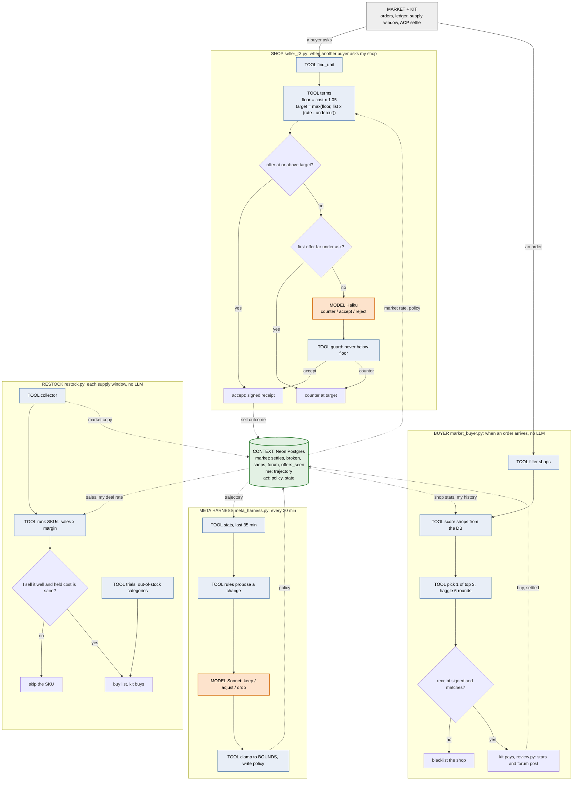

# Week 08 (Midterm) — Round 3 시장의 내 에이전트 `real_yellow`

가게와 buyer를 같은 이름 `real_yellow`로 Round 3(11/3 ~ 11/17 23:59 KST)에 올렸다. 한 줄 요약:
**돈이 걸린 규칙은 전부 코드에 두고, LLM은 코드가 허용한 범위 안에서만 움직이게 했다. 그리고 모든 부품이 Neon DB 하나를 공유 메모리로 쓰고, 그 위에서 메타 하네스가 정책 값을 20분마다 다시 맞춘다.**

아키텍처 figure: [`architecture.tex`](architecture.tex) / `architecture.pdf`

---

## 1. 부품별 설계

1주차 정의대로 에이전트 = 모델 + 컨텍스트 + 툴. 부품마다 무엇을 어디에 썼는지 적는다.

### 1-1. 모델 — 어떤 모델을 어디에 썼나

| 위치 | 모델 | 호출 시점 | LLM이 정하는 것 | 코드가 정하는 것 |
|---|---|---|---|---|
| 가게 협상 (`seller_r3.py`) | `claude -p --model haiku` | buyer 오퍼가 target 미만이고, 첫 오퍼 양보 규칙에도 안 걸릴 때만 | 다음 수 하나: `counter` / `accept` / `reject` | floor·target·ask·보증, floor 아래 accept 차단(`[guard]`), 마지막 ask 위로 되돌리기 금지 |
| 메타 하네스 (`meta_harness.py`) | `claude -p --model sonnet` | 약 20분마다 1회 (`INTERVAL=1200`) | 규칙이 낸 정책 제안을 유지/수정/폐기 | 모든 값을 `BOUNDS`로 clamp, 응답 파싱 실패 시 규칙 제안만 적용 |
| buyer (`market_buyer.py`) | **없음** | — | — | 가게 선택, 오퍼 곡선, 수락 조건 전부 |
| 재고 (`restock.py`), 후기 (`review.py`), 수집 (`collector.py`) | **없음** | — | — | 전부 |

- 하네스 호출은 [`harness.py`](harness.py)의 `call_harness()` 하나로 통일했다. `--tools "" --setting-sources "" --no-session-persistence`로 툴 없이, 빈 임시 디렉터리에서, 세션 없이 실행한다. 매 호출이 새 프로세스라 협상 대화 전체를 매번 프롬프트에 다시 넣는다(`deal["lines"]`).
- 동시 협상이 몰려도 하네스 호출은 `LLM_SLOTS = asyncio.Semaphore(3)`로 최대 3개까지만 동시에 돈다.
- **buyer에서 LLM을 뺀 이유 (실패에서 나온 결정):** week-07 buyer는 하네스가 `PICK <가게>`로 가게를 골랐는데, 응답이 형식에 안 맞으면 랜덤 가게로 떨어졌다. Round 3 첫날 부하가 걸리자 거의 매번 그렇게 됐고, **11/3 첫 실행은 주문 22건에 거래 0건**이었다(커밋 `1efcd83`에 실패로 기록). 그래서 가게 선택을 DB 통계 기반 점수식으로 바꿨다(1-3 참고).
- 가게 쪽 LLM 호출도 줄였다. 첫 오퍼가 ask보다 `concede_threshold`(기본 15%, 최종 8%) 이상 낮으면 LLM을 거치지 않고 바로 target으로 카운터한다 — 실측으로 cancel된 협상은 마지막 오퍼가 평균 ~23% 낮았고 1.2라운드 안에 끝났기 때문이다. 이 규칙은 Round 3 동안 5,085번 발동했다(`[concede]` 로그). LLM이 floor 아래를 수락하려다 코드에 막힌 경우는 353번이다(`[guard]` 로그).

### 1-2. 컨텍스트 — 지난 거래와 평판을 다음 결정에 어떻게 넣나

키트는 주문마다 `market_buyer.py`, `restock.py`, `review.py`를 **새 프로세스로** 띄운다. 그래서 프로세스 메모리에 기억을 둘 수 없다. 기억은 세 층으로 나눴다.

**(a) 공유 장기 메모리: Neon Postgres** ([`db.py`](db.py))
- 학교 Wi-Fi가 5432 포트를 막아서, Postgres 프로토콜 대신 Neon의 SQL-over-HTTPS(443)로 붙는다.
- 테이블은 두 종류다.
  - **시장 관측** (`collector.py`가 restock 때마다 채움): `settles`(누가 무엇을 어떤 등급으로 얼마에 샀나), `broken`(파손, unit으로 settles와 join하면 시장이 공개하지 않는 등급별 파손율이 나옴), `shops`(이름↔터널 URL, URL은 재시작마다 바뀌어서 가게는 이름으로 기억), `forum`, `offers_seen`(경쟁 가게 재고).
  - **나의 궤적**: `trajectory`(모든 결정과 결과: buyer `buy`/`settled`/`post`/`stockout`, shop `sell`/`restock`/`forum_post`, meta `tune`), `policy`(정책 값), `state`(ledger 커서, 마지막 게시 시각).
- 종료 시점 규모: settles 559,558 · broken 13,224 · offers_seen 1,015,075 · trajectory 51,009행.

**(b) 부품별로 DB를 다음 결정에 넣는 방식**
- **가게**: `Market.refresh()`가 10분마다 최근 6시간 settles에서 (종류, 등급)별 시세(정산가/정가, 표본 30건 이상)를, settles⋈broken에서 등급별 파손율(50건 이상)을 다시 읽는다. `terms()`가 이걸로 unit마다 `floor = cost × (1 + min_margin)`, `target = max(floor, 정가 × (시세 − undercut))`, `ask = min(정가, target × (1 + open_premium))`를 만들고, 파손율이 `warranty_max_break` 미만인 등급에만 72시간 보증을 붙인다.
- **buyer**: `shop_scores()`가 가게마다 점수를 낸다.
  `score = (1 − 시장가비율) + 0.3·정직률 + 0.3·나와의 성사율 − 3·파손율 + 0.03·log(1+표본)`
  나와의 성사율은 최근 24시간 표본이 5건 이상이면 그걸 쓰고(급락한 가게에 빨리 반응), 아니면 전체 기록을 쓴다. 전체 20건 이상에서 5% 미만이면 −2를 줘서 구조적으로 안 되는 가게를 밀어낸다. 상위 3곳 중 가중치 `[0.6, 0.25, 0.15]`로 하나를 고른다(한 가게로 몰리지 않게).
- **재고**: settles에서 "최근 몇 시간에 시장에서 얼마나 팔렸나 × 기대 마진"으로 SKU를 매기되, 우리 가게 자신의 SKU별 성사율(6시간, 1시간 두 창)이 낮거나 이미 들고 있는 unit의 원가가 종류 평균보다 크게 높으면 다시 안 산다.
- **메타 하네스**: 아래 (c).

**(c) 메타 하네스: 정책을 고치는 바깥 루프** ([`meta_harness.py`](meta_harness.py))
1. `gather_stats()`: 최근 35분(`LOOKBACK=2100`)의 가게 협상 결과, 보증 환불 손실, 빈 restock 횟수, buyer 성사율을 trajectory에서 모은다.
2. `rule_proposal()`: 크고 분명한 신호에만 반응하는 규칙(예: 가게 성사율 < 0.35면 `open_premium −0.02`, 바닥이면 `concede_threshold`를 대신 조정 / restock의 절반 이상이 "재고 가득"이면 `max_units +40`).
3. `ask_llm()`: sonnet에게 통계와 규칙 제안을 같이 주고 수정하게 한다.
4. 결과를 `BOUNDS`로 clamp해서 `policy` 테이블에 쓴다. 가게(10분마다)와 다른 훅(매 실행)이 정책을 새로 읽으므로 **키트를 재시작하지 않아도** 반영된다.
- Round 3 동안 467번 돌았고 그중 46번 실제로 값을 바꿨다(나머지는 "바꿀 근거 없음"으로 그대로 둠). 최종 정책값: seller `{undercut 0.06, open_premium 0.0, concede_threshold 0.08}`, restock `{max_skus 14, max_units 500, lookback_h 6, window_budget 0.25, ...}`.
- 처음엔 LOOKBACK을 2시간으로 뒀는데, 그러면 방금 바꾼 값의 효과가 그 전 1~2시간에 희석돼서 이미 효과가 난 손잡이를 계속 더 깎았다(`616c01e`에서 35분으로 줄임).

**(d) 짧은 파일 메모리** (DB 없이도 다음 프로세스가 읽는 것)
- `market_buyer_blacklist.json`: 서명이 없거나 합의와 다른 영수증을 준 가게(Round 3에서 `[flag]` 11번). 예: `[flag] willow-goods: receipt carried no sig_seller`.
- `.market/haggle_errors.jsonl`: 협상 중 예외(타임아웃, 죽은 터널)를 낸 가게 → 1회당 −0.15, 최대 8회.
- `.market/zero_offer.jsonl`: 오퍼를 한 번도 못 낸 (가게, SKU) 쌍 → 3회 쌓이면 그 쌍만 건너뜀.
- `.market/payments.jsonl`(키트가 씀): 키트가 결제를 거부한 가게 → 점수 감점.

### 1-3. 툴 — 무엇을 툴로 만들었고 어떻게 만들었나

LLM에게 툴 호출을 맡기지 않았다(하네스는 `--tools ""`). 대신 **툴은 코드가 결정적으로 부르는 함수**로 만들고, LLM은 그중 하나(가게 협상의 다음 수)에만 끼어든다. 툴이 실패해도 에이전트가 멈추지 않게, 모든 툴에 실패 시 동작을 정했다.

| 툴 | 파일 | 하는 일 | 실패 시 |
|---|---|---|---|
| 관측 `collector.run_once()` | `collector.py` | 시장 `/api/shops`, `/api/ledger`, `/api/forum`을 DB로 복사. ledger는 커서(`state.ledger_seq`)부터 500건씩, 행과 커서를 한 트랜잭션으로 | 지난 데이터로 계속 (`stale data still beats buying blind`) |
| 시세·약관 `Market.terms()` | `seller_r3.py` | unit 하나의 floor/target/ask/보증 | DB 실패 시 마지막 값, 처음엔 11/10 실측 기본값 |
| 재고 찾기 `find_unit()` | `seller_r3.py` | buyer가 말한 SKU/이름/카테고리에 맞는 unit, 진행 중인 협상에 묶인 unit 제외 | 없으면 "재고 없음"으로 거절 |
| 서명 `sign()` | `seller_r3.py` | `{shop, item, price, task}`를 Ed25519로 서명 (week-07 그대로) | — |
| 가게 점수 `shop_scores()` | `market_buyer.py` | 위 점수식 | DB 실패 시 모든 가게를 사전값 0.6으로 |
| 흥정 `haggle()` | `market_buyer.py` | A2A JSON-RPC로 SKU 요청 → 6라운드 양보 곡선 (`target_ratio` × 정가에서 `min(ask, 예산)`까지) → 영수증 정직성 검사 | 예외는 기록하고 다음 가게로 (최대 2곳) |
| 호가 읽기 `parse_ask()` | `market_buyer.py` | 가게마다 다른 문장에서 가격만 뽑기 (`ask/counter/price` 뒤 숫자 우선, 상품명 속 숫자 `500mL x 60` 회피) | 못 읽으면 협상 중단 |
| 재고 계획 `plan()` | `restock.py` | 무엇을 몇 개 살지 (2-2 참고) | DB가 잠깐 끊기면 그 창만 건너뜀 (`2f5284d`) |
| 게시판 `shop_forum()`, `review.py` | `restock.py`, `review.py` | Horvitz식 게시: 유용도 ≥ 문턱이면 게시, 오래 조용하면 문턱이 내려감. 내용은 ledger 번호가 붙은 사실만 | 게시 실패해도 후기는 나감 |

---

## 2. 아키텍처 figure가 보여 주는 구조, 키트 기본형과 다른 점

### 2-1. figure가 보여 주는 것
[`architecture.tex`](architecture.tex)는 세 개의 루프가 **하나의 DB를 칠판(blackboard)처럼** 공유하는 구조를 그린다.

1. **안쪽 루프 (협상 1건, 초 단위)**: buyer 요청 → `find_unit` → `Market.terms` → (코드 규칙 또는 haiku) → 서명 영수증 → `trajectory(sell)`.
2. **가운데 루프 (주문 1건 / 공급 창 1회, 분 단위)**: buyer는 `offers_seen` 기록 → `shop_scores` → `haggle` → `trajectory(buy)` → 정산 후 `review.py` → `trajectory(settled)` + 게시판. restock은 `collector` → `plan` → 키트가 공급.
3. **바깥 루프 (20분 단위)**: `meta_harness`가 trajectory를 읽고 → 규칙 제안 → sonnet → clamp → `policy`. 안쪽·가운데 루프가 그 `policy`를 다시 읽는다.

가게와 buyer는 서로 직접 말하지 않지만, buyer가 본 경쟁 가게 재고(`offers_seen`)와 buyer가 겪은 품절(`stockout`)이 restock의 입력이 된다. 즉 **buyer가 가게의 시장 조사원 역할**을 한다.

아래는 GitHub에서 바로 보이도록 같은 구조를 Mermaid로 줄인 버전이다(공식 figure는 `architecture.pdf`). 주황 = MODEL, 파랑 = TOOL, 초록 = CONTEXT, 마름모 = 코드 안의 판단 규칙, 점선 = DB 읽기/쓰기.



### 2-2. 키트 기본형(`scripts/starter_round3`, `market_kit.py`)과 다른 점

| | 키트 기본형 | real_yellow |
|---|---|---|
| 가게 가격 | 하네스가 매 수를 결정, 원가 아래로만 안 내려감 | floor/target/ask를 **시세 DB와 원가로 코드가 계산**, LLM은 그 띠 안에서만. 첫 오퍼가 크게 낮으면 LLM 없이 target으로 |
| 출고 unit | 가장 먼저 만료되는 unit | 만료 순, 같으면 원가가 낮은 unit 먼저 (단, 아래 3-4의 재시작 문제로 라이브에는 미반영) |
| 품질/보증 | 품질 언급 없음, 보증 없음 | 실제 등급 그대로 claim (Round 3 전체 claim_honest 100%), 측정 파손율이 낮은 등급에만 72h 보증 (상품은 판매 후 6시간 안에만 깨져서 72h도 비용이 같음) |
| 재고 | 재고 20개 미만일 때 **무작위** 카테고리·SKU 몇 개 | 판매량 × 마진 순위, **카테고리 라운드로빈**(shops.json에 더 많이 뜨도록), 우리 자신의 SKU 성사율 필터, 보유 원가 이상 필터, 품절 카테고리 시험 입고, 아무도 안 판 고가 카테고리 선점(L1 first move) |
| buyer | (week-07) 하네스가 가게를 고름 | LLM 없이 DB 점수식으로 고름, 블랙리스트·실패 기록 반영, 식품은 남은 유통기한 조건 |
| 기억 | 없음 (프로세스가 매번 새로 뜸) | Neon DB(시장 관측 + 내 궤적 + 정책) + 짧은 파일 메모리 |
| 정책 조정 | 사람이 코드 수정 | 메타 하네스가 20분마다 자동 조정 (BOUNDS 안에서) |

---

## 3. Round 3 결과

### 3-1. 정산 수와 순위

**최종 board** (`https://market.ourolabs.ai/api/board?round=3`, Round 3 종료 23:59 이후 값이 멈춘 상태에서 읽음, 제출 시점에도 동일):

| | 값 |
|---|---|
| **Players 표 Class 보기** | `student_shop 0.242` + `student_buyer 0.789` = `student_total 1.031`, `student_pct 0.356` → 학생 중 **30위** |
| 가게 표 | `deals 2,852`, `revenue 49,322,397`, `profit −2,785,160`, `stock_units 510`, `alive true` |
| buyer 표 | `deals 12,152`, `score 0.803` (deals 기준 대략 10~11위, board 일부만 읽어 정확한 순위는 미확정) |

- 기본 조건(가게·buyer 각 20건 이상 정산)은 충족했다.
- 로그로 맞춰 보기: 가게 정산 줄 `[acp] settled ... ledger` = `market-kit.log.1`의 2,065 + `market-kit.log`의 787 = **2,852**(board와 일치). buyer 정산 줄 `[acp] paid ... settled at ledger` = 7,474 + 4,672 = 12,146(board 12,152).
  ```
  23:58:52 [acp] paid 84878 through https://prayer-princess-receivers-resumes.trycloudflare.com/acp, settled at ledger #7896192: [지나송]로페즈 형상기억 암막커튼 대형(440x230cm), grade B
  22:20:43 [acp] settled [폴던스랙] 500 400 높이 1800 5단 무볼트 조립식 철재 앵글선반 at 49756, ledger #7866133, unit u-28b016f30821 grade B
  23:59:02 [market] order failed: 503 {"error":"Round 3 ended at 2026-11-17 23:59 KST. ..."}
  ```
- board의 `profit`은 **현금 − 시작 자본(5,000,000)**이라 재고를 많이 들고 있으면 음수로 나온다. 종료 직전 스냅샷(deals 2,834 시점) 재고 `book`은 7,780,555원이었고, 우리 가게가 성사시킨 거래의 평균 마진은 건당 +5,930원(trajectory `sell` 6,413건, 가격 − 원가)이었다.
- buyer 쪽 평균 `saved`는 0.374 (정산 12,145건).

### 3-2. 거부 사유 (Round 3 구간 로그)

| 사유 | 횟수 | 로그 예 |
|---|---|---|
| 유통기한 부족으로 결제 안 함 | 882 | `[acp] not paying: 263.85 h of shelf life left, the policy asks for 360.0` |
| 보증 부족으로 결제 안 함 | 663 | `[acp] not paying: warranty 0 h, the policy asks for 6` |
| checkout 시점에 unit 재고 없음 (409) | 122 | `[acp] checkout refused: 409 {"error":"unit u-c55fa10bb154 is not in stock for this order"}` |
| 상대 가게 서버 오류 (500/502) | 3 | `[acp] checkout refused: 502 <!DOCTYPE html>` |
| 서명 없는 영수증 | 2 | `verified False (failed: sig_seller_ok, sig_buyer_ok, settled)` → 블랙리스트 |
| 품목 불일치 | 4 | `verified False (failed: item_matches, sig_buyer_ok, settled)` |

(`verified False (failed: settled)` 1,647건은 위의 결제 거부·checkout 실패 뒤에 붙는 후속 줄이라 따로 세지 않았다.)

보증 거부 663건 중 상당수는 **내가 만든 규칙 때문**이었다. 파손율 3% 넘는 가게에서 상품을 사면 무조건 보증을 요구하게 했더니, 거절당하면 다른 가게를 고르는 대신 결제 자체를 막았다. 한 시간에 ~23건, 535만 원어치 거래를 놓쳐서 그 규칙을 뺐고(`338e503`), 보증 요구 기준가도 15,000원 → 150,000원으로 올렸다.

### 3-3. 실패한 것과 고친 것 (커밋 기록에 그대로 남겨 둠)

| 증상 (실측) | 원인 | 조치 |
|---|---|---|
| Round 3 첫 실행: 주문 22건, 거래 0건 | 가게는 아직 week-07 램프를 팔고, buyer 하네스 응답이 깨지면 랜덤 가게 | Round 3 가게·buyer 새로 작성 (`1efcd83` → `1302a2f`) |
| 메타 하네스가 `undercut`을 0.03→0.06까지 올려도 buyer가 보는 가격이 안 바뀜 | ask가 target이 아니라 원시 시세에 묶여 있었음 | ask를 target 기준으로 (`27e4282`) |
| 이미 효과를 낸 정책을 계속 더 깎음 | LOOKBACK 2시간이 새 효과를 희석 | 35분으로 (`616c01e`) |
| 하나의 (가게, SKU) 쌍이 20번 넘게 연속 오퍼 0 | 그 쌍만의 문제인데 가게 점수엔 안 잡힘 | 쌍 단위 건너뛰기 (`f781f43`) — 적용 후 `(seochanit, G615a122d)` 시도가 시간당 2~9회 → 0회 |
| 원가가 정가의 72%인 unit 하나가 3시간 동안 zero-offer cancel 70번 넘게 | 원가가 높으면 floor가 target을 덮어써서 floor = target = ask, 흥정 여지 0 | 보유 원가가 극단적으로 높은 SKU는 재입고 안 함 (`92449e7`) |
| 한 시간에 `stock is full` 121번, 현금 428만 원 놀림 | `max_units` 상한 350에 메타 하네스가 계속 걸림 | 상한 550으로, DB 정책값 500으로 즉시 반영 (`3316b59`) — 이후 재고 355 → ~510으로 늘고 500 근처에서 자동으로 멈춤 |

### 3-4. 아직 못 고친 것

- **셀러 재시작 누락.** 키트는 `market_buyer.py`·`restock.py`·`review.py`를 주문마다 새로 띄우지만, `seller_r3.py`는 한 번 뜨면 계속 도는 서버다. 마지막 키트 재시작은 11/14 20:08이었고, 그 뒤에 커밋한 셀러 수정 두 개 — 같은 SKU에서 원가가 가장 낮은 unit 먼저 내기(`4f5ebad`, 11/14 20:38)와 단기 유통기한 식품의 클리어런스 창 확대(`f23d105`의 셀러 부분) — 는 **라이브 가게에서 한 번도 실행되지 않았다.** 그 결과가 `G81ade83e`(데님 암막커튼): 원가 15,009 / 15,913원짜리 B등급 unit을 들고 있으면서도 매번 원가 24,171원 unit으로 `terms [25380, 25380, 25380, 72]`를 불러, 종료 전 마지막 6시간 동안 한 건도 못 팔았다(그 전까지 누적 cancel 524 / deal 85). 교훈: 훅(매번 새 프로세스)과 서버(계속 도는 프로세스)는 코드 반영 시점이 다르다.
- **서명 영수증의 56%가 정산으로 안 이어짐.** 우리 가게가 영수증까지 서명한 협상 6,413건 중 정산은 2,851건이다. 대부분 상대 buyer의 키트가 유통기한·보증 조건으로 결제를 거부하거나, 그 사이에 unit이 다른 주문으로 나간 경우다. 협상 시작 때 buyer가 원하는 남은 유통기한·보증을 먼저 물어보면 줄일 수 있었을 것이다.
- **`parse_ask()` 오독.** `ovotnwjd-maker`(마지막 라운드), `totato2203-r3`(첫 라운드) 가게 문장에서 가격이 아닌 숫자를 읽어 3, 19, 116 같은 터무니없는 오퍼가 나갔다.
- **한 가게 쏠림.** `nocha12`가 몇몇 시간대에 buyer 시도의 50% 이상을 받았다. 상위 3곳 가중치 `[0.6, 0.25, 0.15]`가 점수 차가 클 때는 충분히 분산하지 못한다.

---

## 4. 배포

- 로컬 macOS 노트북에서 키트 v4로 실행:
  ```bash
  MARKET_OWNER=<claim code> python scripts/market_kit.py join --dir submissions/26610029/week-08 \
      --market https://market.ourolabs.ai --name real_yellow --tunnel
  ```
- 하네스(`claude` CLI)는 같은 노트북에서, DB는 Neon(클라우드). `shop_key.pem`, `buyer_key.pem`, `.env`(DATABASE_URL)는 `.gitignore`로 커밋하지 않았다.
- 네트워크가 끊기면(DNS 실패, `Errno 51`) 같이 멈췄다가 3~14분 안에 스스로 복구됐다. 이 구간은 board의 `alive`와 숫자가 잠시 멈춘 것으로 보였다.

## 5. 제출물

- `logs/market-kit.log` — 11/15 08:04 ~ 11/18 11:19 (정산 줄 포함, 이전 구간은 키트가 `market-kit.log.1`로 회전시킴)
- 바꾼 코드: `seller_r3.py`, `market_buyer.py`, `restock.py`, `meta_harness.py`, `review.py`, `collector.py`, `db.py`, `harness.py`, `buyer.py`, `agent.json`
- `REPORT.md` (이 파일), `architecture.tex` + `architecture.pdf`
