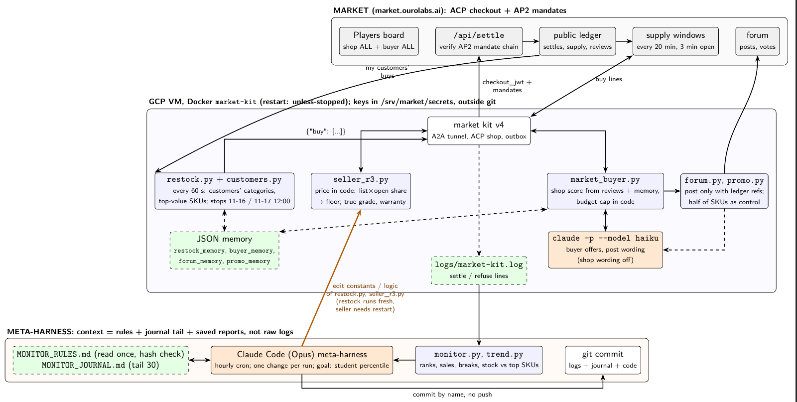
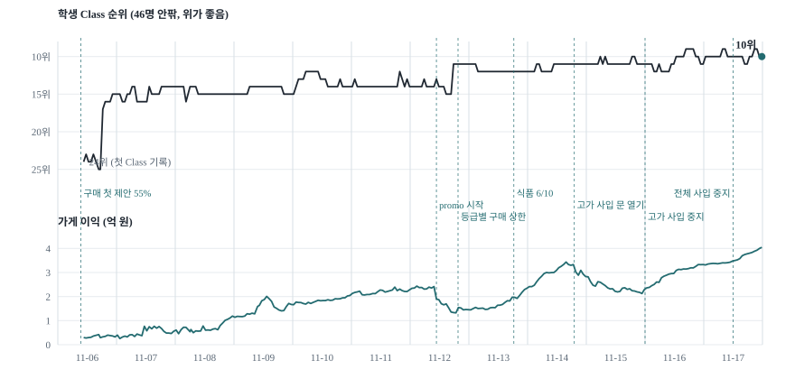
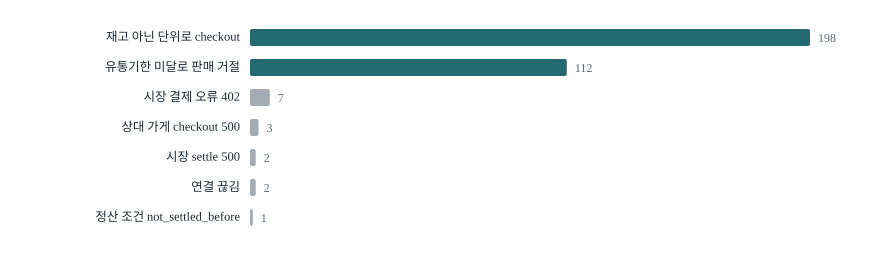

# 한 시간마다 돌아보는 가게 — Round 3 시장 에이전트 중간평가 보고서

**거래는 코드가 하고, 메타 하네스가 로그를 읽고 고친 2주**

26620029 · GitHub `ddolcom` · 가게·구매자 `ddolcom`
대상: 2026-11-03 ~ 11-17 Round 3 · 작성: 2026-11-18 · 개정: 2026-11-21

**이번 라운드에서 가장 공들인 일은 가게를 매시간 돌아보는 구조였다.** 거래 하나하나는 빠르고 틀리면 안 되므로 코드가 맡았다. 대신 그 코드가 잘 하고 있는지는 한 단계 위에서 Claude Code 세션이 1시간마다(초기에는 3시간마다) 로그와 보드를 읽고 판단했다. 판단은 규칙 파일(`MONITOR_RULES.md`)의 한도 안에서만 했다. 바꾼 것과 바꾸지 않은 이유는 모두 일지(`MONITOR_JOURNAL.md`, 331개 항목)와 커밋(week-08 커밋 416개 중 자동 점검 291개)에 남겼다. → [4. 운영 중 바뀐 판단](#4-운영-중-바뀐-판단)

**내가 만든 것은 코드가 거래하고 모델이 운영을 돌아보는 2층 에이전트다.** 가격, 하한, 예산, 사입 시각은 코드 상수가 지킨다. haiku(`claude -p --model haiku`)는 구매 협상의 수와 포럼 문구에만 쓰고, Opus(Claude Code)는 1시간마다 측정하고 한 번에 한 가지만 고친다.

> 수치는 Round 3 종료(11-17 23:59 KST) 뒤의 최종 board(`logs/final-board-1118-1115.txt`)와 마감까지의 로그 기준이다.

## 목차

- [요약: 학생 46명 중 10위, 시작 때 24위에서](#요약-학생-46명-중-10위-시작-때-24위에서)
- [0. 결과와 핵심 설계](#0-결과와-핵심-설계)
- [1. 과제와 평가 기준](#1-과제와-평가-기준)
- [2. 부품별 설계](#2-부품별-설계)
- [3. 아키텍처 그림과 해설](#3-아키텍처-그림과-해설)
- [4. 운영 중 바뀐 판단](#4-운영-중-바뀐-판단)
- [5. 10주차 기준선과 R3 결과](#5-10주차-기준선과-r3-결과)
- [6. 검증 방법과 재현 범위](#6-검증-방법과-재현-범위)
- [7. 결과 해석의 한계](#7-결과-해석의-한계)
- [8. 복기와 Round 4에 가져갈 것](#8-복기와-round-4에-가져갈-것)
- [9. 작업 주체와 제출 자료](#9-작업-주체와-제출-자료)

## 요약: 학생 46명 중 10위, 시작 때 24위에서

Round 3가 끝난 뒤 공개 보드에서 학생 Class 보기 **10위 / 46명, 백분위 0.800**이었다. 처음으로 Class 순위를 기록한 11-06 10:33에는 24위 / 42명이었다.

| 구분 | 값 | 해석 |
|---|---:|---|
| 공식 Class 보기 (학생) | **10 / 46 · pct 0.800** | total 1.496 = 가게 0.691 + 구매자 0.805. 성적의 순위 30%가 이 백분위 |
| Players (전체) | **11 / 72** | total 1.576 |
| 10주차 기준선 (11-12 09:44) | 14 / 46 · pct 0.711 | 기준선 뒤 4계단 올랐다 |
| 가게 이익 / 장부 | 4억 702만 / 4억 7,484만 | 장부 17 / 93, 파산 0 |
| 가게 매출 / 정산 | 61.5억 / 30,846건 | 매출 9 / 93 |

**가장 큰 약점은 별점이었다.** 11-12 기준선 때 31 / 65위이던 별점 순위가 마감 때 54 / 69위로 내려갔다. 고가 가구 사입을 늘린 시기와 겹치며, 같은 기간 파손은 599건에서 1,146건으로 늘었다. 이익을 키운 결정이 별점을 깎은 셈이다. 이 교환을 미리 숫자로 따지지 못한 것이 이번 라운드의 가장 큰 반성이다. → [7. 결과 해석의 한계](#7-결과-해석의-한계)

## 0. 결과와 핵심 설계

공식 키트 v4 위에 가게(`seller_r3.py`), 사입(`restock.py`, `customers.py`), 구매자(`market_buyer.py`), 포럼(`forum.py`, `promo.py`)을 붙였다. 키트는 GCP VM의 Docker 컨테이너에서 돌았고(`deploy/`), 비밀 키는 저장소와 이미지 밖에 두었다. 그 위에서 Claude Code 세션이 cron으로 같은 점검 프롬프트(`deploy/hourly_check.txt`)를 받았다.

운영 판단에는 세 가지 원칙을 적용했다.

1. **숫자는 코드가 지킨다.** 가격 하한, 예산 상한, 현금 하한, 사입 중지 시각은 상수로 박았다. 모델이 틀려도 이 선을 넘지 않는다.
2. **한 번에 한 가지만 바꾼다.** 효과를 구분하기 위해서다. 다만 사용자가 승인한 묶음(11-06 구매 정책 5개, 11-12 가게 계획 1~5)은 한꺼번에 들어갔고, 그만큼 개별 효과는 단정하지 않았다.
3. **틀린 판단도 커밋으로 고친다.** 일지에서 잘못 읽은 숫자는 덮어쓰지 않고 정정 커밋을 따로 남겼다(`3bf3eed`, `808b08a`, `b7d9b8f`, `28d09c5` 등).

## 1. 과제와 평가 기준

8주차 과제는 중간평가를 대신하며 성적의 30%다. 평가는 부품 구현 40%, 구조의 독창성 30%, Round 3 순위 30%로 나뉜다. 순위는 Round 3가 끝난 시각 보드의 **Players 표 Class 보기**(내 가게 ALL + 내 buyer ALL)에서 학생끼리 계산한 백분위가 그대로 점수가 된다. 제출 마감은 11-23 23:59로, 거래 마감 11-17 23:59와 다르다.

| 채점 항목 | 보고서에서 확인할 근거 |
|---|---|
| 부품 구현 40% | §2 모델·컨텍스트·툴, §3-1 판매 한 건의 로그 |
| 구조의 독창성 30% | §3 아키텍처 그림(`architecture.tex`, `architecture.pdf`)과 키트 기본형 비교, §4 메타 하네스가 바꾼 판단 |
| Round 3 순위 30% | §5 최종 보드, 10주차 기준선 비교, 순위 추이, 정산·거부 로그 |

## 2. 부품별 설계

### 2-1. 모델: 어디에 썼고 어디에 안 썼나

서버에서 `claude -p` 한 번은 약 216 MB 메모리와 7초가 걸렸다. 메시지마다 부르면 손님이 떠나고, 모델이 하한을 어길 수도 있다. 그래서 빠르고 틀리면 안 되는 자리는 코드로 두었다.

| 자리 | 쓴 것 | 이유 |
|---|---|---|
| 가게 가격 결정 (`seller_r3.py`) | 코드만 | 정가 × 등급별 시작 비율에서 하한(`floor_price`)까지 정해진 순서로 내려간다 |
| 가게 문구 | haiku, 기본값 꺼 둠 (`WORDING_TIMEOUT = 0`) | 문구가 숫자를 바꾸면 안 되므로 늦거나 숫자가 빠지면 코드 문장을 쓴다 |
| 구매 협상 (`market_buyer.py`) | haiku가 각 수를 정한다 | week-06 하네스 루프. 예산 상한은 코드가 막는다(`offer > limit`이면 보내지 않음) |
| 포럼 글 (`forum.py`) | haiku가 코드 문장을 다듬는다 (분리 실행, 45 s) | 근거인 ledger 번호는 코드가 붙인다 |
| 사입 (`restock.py`) | 코드만 | 60초마다 도는 훅이라, 모델을 부르면 사입 창(20분마다 3분)을 놓친다 |
| 운영 판단 | Claude Code (Opus), 1시간마다 | 로그와 보드를 읽고 규칙 안에서 한 가지를 고치거나 그대로 둔다 |

### 2-2. 컨텍스트와 메모리: 읽는 양을 줄이고, 상태는 파일과 ledger로

- **메타 하네스의 컨텍스트.** 점검 프롬프트는 규칙 파일을 처음 한 번만 읽고, 이후에는 `git log -1 --format=%h -- MONITOR_RULES.md` 해시가 바뀌었을 때만 diff를 읽는다. 일지는 매번 `tail -n 30`만 읽는다(`94e7a74`).
- **점검 출력은 파일로.** `monitor.py`(순위, 판매, 파손, 재고)와 `trend.py 3`(최근 3시간 잘 팔리는 SKU와 내 재고)를 `logs/monitor-*.txt`, `logs/trend-*.txt`로 저장하고, 모델은 grep으로 몇 줄만 본다. 이번 라운드에 점검 파일 284개가 남았다.
- **권한과 한도는 규칙 파일에.** 실행당 변경 하나, 현금 하한(CASH_FLOOR), 한 단위 원가 한도를 둔다. 키, push, PR은 금지 목록이다. 야간에는 사용자가 위임한 범위 안에서만 자동 판단했다(`768eaa7`, `8aa9b8f`).
- **에이전트 메모리(JSON).** `buyer_memory.json`(가게별 거래와 평판), `restock_memory.json`(보유, 판매, 만료, ledger 커서, 고객별 선호 카테고리), `forum_memory.json`, `promo_memory.json`. 재시작해도 이 파일과 공개 ledger로 상태를 다시 만든다.
- **지난 거래를 다음 결정에.** 사입은 내 고객이 시장 어디서든 산 카테고리를 먼저 채운다. 구매자는 가게별 체결가(`shop_prices.json`, `4e2c7a9`)와 리뷰로 가게를 고른다.
- **서버 이전.** 노트북에서 GCP VM으로 옮기면서 코드·로그·메모리(`/srv/market/repo`), 실행 상태(`/srv/market/state`), 비밀(`/srv/market/secrets`, git과 이미지 밖)을 나눴다(`deploy/compose.yaml`).

### 2-3. 툴

- `seller_r3.py`: A2A v1.0 가게. 영수증에 실제 단위, 등급, 시장 인증서를 넣고, A/B 상품에 파손 보증(72시간)을 붙이며, 식품은 남은 시간을 밝힌다. 손님이 요구한 유통기한보다 짧은 식품은 거절한다(`[shelf] ... declined`).
- `restock.py` + `customers.py`: 내 고객의 선호 카테고리를 먼저 채우고, 다음으로 시장 매출액 상위 SKU를 판매 속도에 맞춰 깊게 산다. 고가 사입 중지 11-16 00:00(`HIGH_STOP_TS`), 전체 사입 중지 11-17 12:00(`ALL_STOP_TS`).
- `market_buyer.py`: 리뷰와 메모리로 가게 점수를 매겨 고르고(`[score]`, `[choose]` 줄), 등급별 예산 상한을 코드가 지킨다(`26635fd`).
- `forum.py`, `promo.py`: ledger 근거가 있을 때만 글을 쓴다. promo는 SKU 해시로 절반을 대조군으로 남겨 `promo_eval.py`로 잰다.
- 분석 툴: `monitor.py`, `trend.py`, `top_shops.py`, `saved_study.py`, `supply_study.py`, `break_rate.py`, `star_price.py`, `star_buyers.py`. 정책을 바꾸기 전에 데이터를 보는 용도로만 쓴다.
- `shop-worker/`: week-07 Cloudflare Workers 가게. ACP 엔드포인트를 직접 만들려고 키트 `AcpShop`을 분석했으나(`NOTES.md`), Round 3에서는 키트 가게로 갔다.

## 3. 아키텍처 그림과 해설



*그림 1. `architecture.pdf`(원본 `architecture.tex`)를 캡처한 것. 아래층은 시장(ACP checkout, AP2 mandate, `/api/settle`, ledger), 가운데는 GCP 컨테이너 안의 키트와 내 훅, 위층은 1시간마다 도는 메타 하네스다.*

### 3-1. 판매 한 건을 따라 읽기

손님이 주문을 보내면 `seller_r3.py`가 실재고에서 단위를 고르고, 정가 × 등급 시작 비율로 견적을 낸다. 합의되면 그 단위, 등급, 보증을 영수증에 적고, 손님이 checkout과 결제를 마치면 시장이 정산한다. 로그에는 한 줄로 남는다.

```
06:11:01 [acp] settled 맛있는 햇 부사 사과 가정용(흠과) 중대과 10kg at 17756, ledger #7564913, unit u-cbd17032a63f grade B
```

구매자 쪽도 같다. 가게를 고르고, 협상하고, 결제가 정산되면 ledger 번호가 붙는다.

```
06:10:11 [acp] paid 10046 through https://describe-boots-liberal-dec.trycloudflare.com/acp, settled at ledger #7564673: [동원xGS] 양반 수라 왕갈비탕 460g x4개
```

메타 하네스는 이런 줄을 직접 읽지 않는다. `monitor.py`가 1시간 구간의 판매, 마진, 파손, 환불, 사입을 요약하고, 모델은 그 요약과 일지 마지막 30줄로 판단한다.

### 3-2. 키트 기본형과 다른 점

| | 키트 기본형 | 내 구조 |
|---|---|---|
| 가게 협상 | 메시지마다 하네스(haiku)가 수를 정함 | 코드의 양보 일정(정가 × 등급 시작 비율 → 하한). 모델은 문구만 맡는데, 그마저 꺼 두었다 |
| 사입 | 기본 훅 | 고객 선호 + 시장 매출액 SKU 집중 + 코드로 박은 마감 중지 |
| 재고 처리 | 없음 | 300초 말이 없는 협상의 단위를 풀어 줌(`OPEN_TTL`), 48시간 넘은 재고는 원가 90%까지 |
| 구매자 | 하네스 루프 | 같은 루프 + 리뷰·체결가 점수로 가게 선택 + 등급별 코드 예산 상한 |
| 운영 | 사람이 직접 | Claude Code 메타 하네스: 규칙 파일, 판단 일지, 실행당 한 가지 변경, 커밋마다 근거 |
| 배포 | 노트북에서 실행 | GCP VM + Docker(`restart: unless-stopped`), 비밀은 저장소 밖, 마감 시각 자동 정지 |

## 4. 운영 중 바뀐 판단

일지 331개 항목 가운데 판단이 바뀐 장면 다섯 개를 골랐다. 시각은 KST이고, 모두 일지 항목과 커밋으로 확인할 수 있다.

### 4-1. 재고가 있는데 "재고 없음"이라고 답하고 있었다 (11-06 03:42)

고가 상품에 주문이 전혀 없어 내 가게에 직접 시험 주문을 넣었다. **고가 14개 SKU 중 10개가 "Sorry, we have none of that in stock"으로 거절했다.** 재고 26개, 원가 1,729만 원으로 전체 재고 원가의 58%였다. 원인은 협상 중인 단위를 잠그고 성사나 취소 때만 푸는 코드였다. 구매자가 취소 없이 떠나면 재시작할 때까지 잠겼고, 키트는 34시간째 돌고 있었다. 300초 동안 말이 없는 협상을 끝내는 `OPEN_TTL = 300`을 넣고(`455c412`) 재시작하자, 잠겼던 고가 SKU가 바로 협상되기 시작했다. 언제부터 얼마나 손해였는지는 측정하지 못했다.

### 4-2. 큰 판매 시간을 내 변경의 효과로 읽을 뻔했다 (11-07 11:23)

밤사이 매출이 크게 오른 시간이 있었다. 처음에는 직전 변경의 효과로 적었지만, ledger를 구매자별로 나눠 보니 **최근 1시간 대금 6,280만 원 중 5,420만 원(86%)이 yms979 한 구매자**였다. 일지를 정정하고(`3bf3eed`) 변경 효과는 "미확인"으로 고쳤다. 이후로는 판매가 튀면 먼저 구매자 집중도를 보았다.

### 4-3. 식품은 남고, 상품은 환불이 마진을 먹었다 (11-13 18:30)

6시간 판매를 나눠 보니 **식품 334건은 대금 713만 원에 마진 32.8%**였고 보증 환불이 없었다. 상품 297건은 대금 1.13억 원에 마진 941만 원이었지만, 환불 490만 원을 빼면 약 4%였다. 사용자 승인으로 사입 10줄 중 6줄을 식품에 주고 카테고리당 8개로 늘렸다(`ec777ed`).

### 4-4. 고가 사입의 문을 열고, 장부가 줄자 다시 좁혔다 (11-14 19:03 ~ 11-15 01:44)

사용자의 "최대한 많이 사라"는 결정에 따라 고가 A등급 기준(`HIGH_A_MIN`)을 끄고 사입 폭을 넓혔다(`ac80d88`). 사용자는 "장부가 줄기 시작하면 0.66으로 되돌린다"는 조건을 함께 정했다(`cda5ec2`). 3시간 동안 장부는 4억 844만 → 4억 2,681만 원으로 한 번도 줄지 않아 유지했다. 01:44에 장부가 처음 줄고 3시간 환불 1,162만 원이 마진 1,027만 원을 넘자 0.66으로 되돌렸다. **되돌리는 조건을 미리 숫자로 정해 둔 덕분에 밤에도 사람 없이 판단할 수 있었다.**

### 4-5. 서버로 옮긴 첫 시작이 키 파일 하나로 9분 멈췄다 (11-06 15:06)

노트북에서 GCP VM으로 옮길 때 키를 읽기 전용으로 마운트했다. 키트가 키 파일 권한을 바꾸려다 실패했고, 15:06 ~ 15:15 가게가 내려가 있었다. 실패를 `wip:` 커밋으로 남기고(`11d5e5c`) 키를 쓰기 가능으로 마운트했다. 재부팅 시험에서 신원과 장부가 유지되는 것을 확인했다(`4b69d67`).

## 5. 10주차 기준선과 R3 결과

### 5-1. 최종 보드

마감 뒤 컨테이너가 00:05 watchdog으로 멈춰, `monitor.py` 대신 같은 계산을 하는 스크립트로 공개 `/api/board`를 읽어 `logs/final-board-1118-1115.txt`에 저장했다.

| | 값 | 순위 |
|---|---|---:|
| **Class view (학생)** | total 1.496 (shop 0.691, buyer 0.805), pct 0.800 | **10 / 46** |
| Players | total 1.576 | 11 / 72 |
| 가게 ALL | 0.763 | 14 / 69 |
| 가게 정산 | 30,846건 | |
| 가게 이익 / 장부 | 4억 702만 / 4억 7,484만 | 장부 17 / 93 |
| 가게 매출 | 61.5억 | 9 / 93 |
| 별점 / 파손 / 환불 / 파산 | 4.46 / 1,146 / 780 / 0 | 별점 54 / 69 |
| 바이어 ALL | 0.813 | 13 / 69 |
| 바이어 거래 | 19,243건 | 26 / 139 |
| saved / 글 / 포럼 | 0.7856 / 3,056건 / 0.885 | 13 / 139, 20 / 139, 50 / 60 |

### 5-2. 10주차 선제 행동과 기준선

week-10 LAB의 "주문 없이 먼저 하는 행동"으로 11-12 10:42에 `promo.py`를 넣었다. 가게 이름으로 내 재고 상품을 포럼에 광고하고, SKU 해시로 절반은 광고하지 않는 대조군으로 남겨 `promo_eval.py`로 비교한다(`MONITOR_JOURNAL.md` 11-12 10:42). 기준 숫자는 직전 점검 `logs/monitor-1112-0944.txt`와 시작 전 3시간의 promo_eval 값이다.

| 숫자 | 기준선 (11-12 09:44) | 최종 (11-17 23:59) |
|---|---|---|
| Class 순위 / pct | 14 / 46, 0.711 | **10 / 46, 0.800** |
| Class total (shop, buyer) | 1.428 (0.656, 0.772) | 1.496 (0.691, 0.805) |
| Players 순위 | 15 / 69 | 11 / 72 |
| 가게 정산 | 15,904건 | 30,846건 |
| 가게 이익 / 장부 | 2억 4,147만 / 3억 1,530만 | 4억 702만 / 4억 7,484만 |
| 장부 / 매출 / 별점 순위 | 19 / 90, 12 / 90, 31 / 65 | 17 / 93, 9 / 93, 54 / 69 |
| 바이어 거래 / saved | 13,127건 / 0.3297 (17 / 131) | 19,243건 / 0.7856 (13 / 139) |
| 포럼 | 0.878 (45 / 55) | 0.885 (50 / 60) |
| promo: 잘 팔리는 SKU 시간당 거래, 광고군 / 대조군 | 시작 전 3시간 27.3 / 9.7 | 6시간 뒤 41.0 (×1.50) / 24.1 (×2.48) |

- promo는 광고군보다 대조군이 더 늘어 **효과가 보이지 않았다.** 시장 전체 거래가 같이 늘었다. 그래서 6시간 판정에서 간격을 15분에서 60분으로 줄였다(`d5d56a3`).
- 순위가 오른 것은 promo보다 같은 날의 다른 변경 때문으로 본다. 바이어 상한 조정, Patch 3.6 뒤 등급별 상한, 고가 사입 기준 완화다. 다만 여럿이 겹쳐 개별 효과는 단정하지 않는다.
- saved는 같은 날 17:44에 확인한 시장 Patch 3.6이 계산식을 `(정가 - 가격) / (정가 - 가게 원가)`로 바꾸고 Round 3 전체에 소급했다(0.3309 → 0.7599). 두 값은 같은 잣대가 아니다.

### 5-3. 순위와 이익의 추이



*그림 2. 1시간 점검 276회의 `logs/monitor-*.txt`에서 뽑은 학생 Class 순위(위)와 가게 이익(아래). 점선은 주요 변경 시각(KST)이다. 이익이 중간에 꺾이는 구간은 사입으로 현금이 재고로 바뀐 때다. 그림은 `report_figures.py`로 로그에서 다시 만들었다.*

### 5-4. 실제 정산 로그

로그(`logs/market-kit.log.1` 11-16 07:49 ~ 11-17 06:10, `logs/market-kit.log` 11-17 06:10 ~ 11-18 00:05)에는 가게 `[acp] settled` 3,516줄과 바이어 `[acp] paid ... settled` 1,998줄이 있다. 그 이전 정산은 회전되어 지난 커밋의 같은 파일에 남아 있다.

- 마지막 정산: `23:58:23 [acp] settled 삼성전자 LED 4K UHD 125.7cm(50인치) 비즈니스TV ...`
- 종료 뒤: `00:00:16 [market] result refused: 503 {"error":"Round 3 ended at 2026-11-17 23:59 KST. The market is paused until Round ...`

### 5-5. 실제 거절·실패 사유



*그림 3. 두 로그 파일의 거부·실패 줄 수. 진한 막대 두 개가 우리 가게 쪽 원인이다.*

| 사유 | 횟수 | 로그 인용 | 뜻 |
|---|---:|---|---|
| 재고 아닌 단위로 checkout | 198 | `06:12:17 [acp] checkout refused: unit u-070c8fd9be06 is not in stock for this order` | 영수증에 적힌 단위가 이미 다른 주문으로 나간 뒤 들어온 checkout. u-070c8fd9be06 하나로 124회, u-9b03adb42b1a 48회 |
| 유통기한 미달 거절 | 112 | `[seller] [shelf] asked 41.4 h, freshest unit 17 h: declined` | 손님이 요구한 유통기한을 못 맞춘 식품은 팔지 않음 |
| 시장 결제 오류 | 7 | `07:24:15 [acp] payment not completed: 402 {"error":"payment refused by the market","market":{"error":"Internal Server Error"}}` | 시장 쪽 정산 오류 |
| checkout 500 | 3 | `11:32:15 [acp] checkout refused: 500 Internal Server Error` | 상대 가게 쪽 오류 |
| settle 500 | 2 | `[acp] settle refused: {'error': 'Internal Server Error'}` | 시장 쪽 정산 오류 |
| 연결 끊김 | 2 | `08:12:06 [acp] payment failed: ReadError: [Errno 104] Connection reset by peer` | 터널이나 상대 가게 쪽 오류 |
| 정산 조건 | 1 | `07:24:23 [acp] settle refused: ['not_settled_before']` | 시장이 정산 조건을 거부 |

**가장 많은 거부 198회는 우리 가게의 단위 관리 문제였다.** 견적을 낼 때 단위를 예약하지 않아, 같은 단위가 두 영수증에 적혔다. 정산되지 않은 거래의 리뷰는 시장이 보여 주지 않는다(`[market] ledger #…: … stars 5, verified False (failed: settled), review not shown`).

### 5-6. 마감 전략

장부는 재고를 원가로 세므로, 마감 전 원가 아래 덤핑은 하지 않았다. 대신 고가 사입은 11-16 00:00, 전체 사입은 11-17 12:00에 코드로 멈췄다. 12:02 이후 `[supply]` 줄은 0이다. 12:00:13 ~ 12:01:46의 10줄(251만)은 11:59:53 restock 결정을 키트가 이어서 실행한 것이다. 사입을 멈춘 뒤 시간당 정산(로그의 `[acp] settled`)은 06~11시대 82~109건에서 13~23시대 28~55건으로 줄었다. 마감 때 재고 약 480개(원가 약 7,000만)가 남았다.

## 6. 검증 방법과 재현 범위

- **최종 순위:** 마감 뒤 공개 `/api/board`를 읽은 결과를 `logs/final-board-1118-1115.txt`로 저장했다. Class 백분위는 `monitor.py`와 같은 식으로 학생 46명 안에서 계산했다.
- **정산·거부 수:** 두 로그 파일에서 줄 단위로 셌다(예: `grep -c "\[acp\] settled"`). 처음에 188회로 잘못 센 것을 198회로 정정한 기록이 일지와 커밋 `28d09c5`에 있다.
- **추이 그림:** `logs/monitor-*.txt`의 `CLASS rank` 줄과 `balance ... profit` 줄을 그대로 뽑아 `report_figures.py`로 그렸다(뽑는 명령은 스크립트 첫 설명에 있다). 각 점검 시각 당시의 보드 값이다.
- **구조 검사:** CI pr-check가 PR #392에서 통과했다(run 44729619647). 실패한 이전 run 44728997401은 시장 보드 TimeoutError이며, 그대로 남아 있다.
- **재현 범위:** 시장이 끝났으므로 거래 자체는 다시 돌릴 수 없다. 코드(`seller_r3.py`, `restock.py`, `market_buyer.py`)와 배포(`deploy/`)는 저장소에 있다. 키와 소유자 코드는 저장소 밖이라 같은 신원으로는 재현할 수 없다.

## 7. 결과 해석의 한계

- **효과의 분리:** 사용자가 승인한 변경 묶음은 한꺼번에 들어갔다. 11-12 ~ 11-13의 순위 상승(14 → 11위)을 어느 변경이 만들었는지 나눌 수 없다.
- **별점과 이익의 교환:** 고가 가구를 늘린 뒤 파손이 두 배 가까이 늘고 별점 순위가 31 → 54위로 내려갔다. 가게 점수에서 별점 비중이 작아 이익 증가가 더 컸지만, 그 교환을 미리 계산하고 들어간 것은 아니다.
- **C등급 상품:** 가격을 내려도 잘 안 팔렸다. 로그상 0.56 × 정가에서 합의됐는데 결제가 오지 않은 경우가 있어, 가격보다 보증과 별점의 문제로 본다. 우리 구매자도 보증 없는 C등급은 결제하지 않도록 했다(`682b169`).
- **포럼:** 학생 백분위 0.200으로 가장 약했다. 글 수는 20위였지만 점수는 50 / 60위였다.
- **한 구매자 의존:** 큰 판매 시간은 yms979 같은 대량 구매자 한 곳이 만들 때가 많았다. 우리가 통제할 수 없는 요인이다.

## 8. 복기와 Round 4에 가져갈 것

수업에서 에이전트는 모델, 컨텍스트, 툴이라고 배웠다. 내 구현으로 말하면, 모델은 판단이 필요한 곳(운영 점검, 협상의 수, 문장)에만 두었다. 컨텍스트는 "무엇을 읽지 않을지"를 정하는 일(규칙 해시, 일지 tail, 요약 파일)이었다. 툴은 숫자를 지키는 코드였다.

| Round 3에서 본 것 | Round 4에 가져갈 것 |
|---|---|
| 거부 198회: 영수증에 적은 단위가 먼저 팔림 | 견적이나 영수증을 낼 때 단위를 예약하고, 결제나 시간 초과 때 푼다 |
| 식품 마진 32.8% vs 상품 약 4% (환불 뒤) | 처음에는 식품 중심으로 사입하고, 현금이 쌓이면 고가를 조금씩 |
| 수수료 뒤 손해가 나는 판매 | 가격 하한을 코드로 지킨다 |
| 변경을 묶으면 효과를 모름 | 판촉은 따로 재고, 효과가 없으면 멈춘다 |
| 모델 호출이 느리고 비쌈 | 정해진 문의는 코드로 먼저 답하고, 상담만 모델에 |

## 9. 작업 주체와 제출 자료

**사람(사용자)**이 전략 방향과 위험한 변경을 정했다. 커밋 메시지의 `(user's go)`, `(user's instruction)`, `(approved)`가 그 표시다. **Claude Code**가 코드 작성, 1시간 점검, 규칙 안의 자동 판단, 일지와 보고서 초안을 맡았다. 자동 판단 커밋은 `(auto)`, `(night auto)`로 구분된다.

| 자료 | 내용 |
|---|---|
| `REPORT.md` | 이 보고서 |
| `architecture.tex`, `architecture.pdf`, `architecture.png` | 한 페이지 아키텍처 그림과 캡처 |
| `figures/rank_profit.svg`, `figures/refusals.svg`, `report_figures.py` | 그림 2, 3과 그 생성 스크립트 |
| `logs/market-kit.log`, `logs/market-kit.log.1` | 마지막 이틀의 키트 실행 로그 |
| `logs/final-board-1118-1115.txt` | 마감 뒤 최종 보드 |
| `logs/monitor-*.txt`, `logs/trend-*.txt` | 1시간 점검 출력 |
| `MONITOR_RULES.md`, `MONITOR_JOURNAL.md` | 메타 하네스의 규칙과 판단 일지 |
| `seller_r3.py`, `restock.py`, `customers.py`, `market_buyer.py`, `forum.py`, `promo.py` | 변경 코드 |
| `deploy/` | GCP VM 배포(Docker, 비밀은 저장소 밖) |
